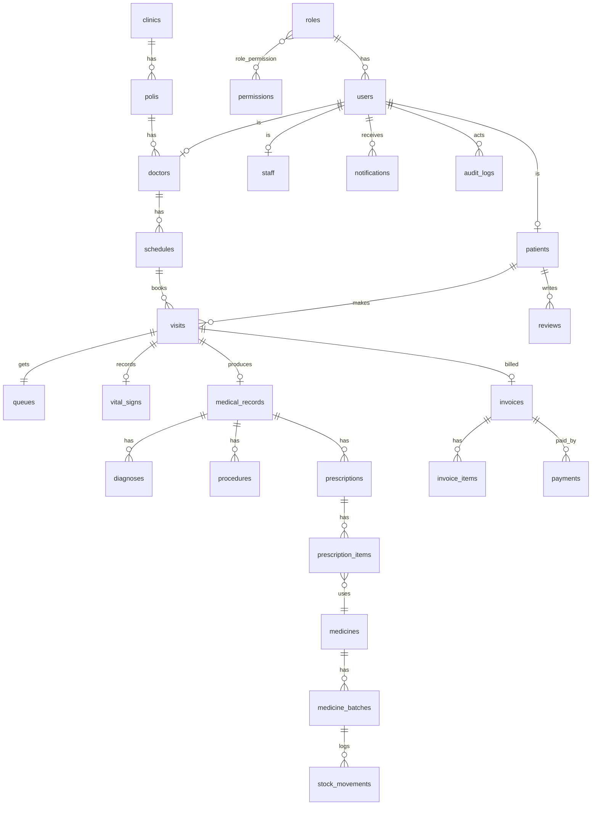

# BAB 1 – Blueprint KlinikSehat

## 1. Analisis Sistem
KlinikSehat adalah sistem informasi klinik rawat jalan: pendaftaran online, antrian, pemeriksaan, rekam medis, resep, apotek, pembayaran, dan laporan. Pengguna: 7 role (Super Admin, Admin Klinik, Pemilik, Dokter, Perawat, Apoteker, Pasien).

## 2. Teknologi
React + Vite + JavaScript, Tailwind CSS, Laravel 12 (REST API), PostgreSQL (`klinik_sehat`, dikelola lewat pgAdmin 4), Laravel Sanctum (token), antarmuka berbahasa Indonesia.

## 3. Arsitektur
```
Browser (React SPA) --HTTPS/JSON--> Laravel 12 API (/api/v1) --> PostgreSQL
                                     |- Middleware: auth:sanctum, role, permission
                                     |- Controller -> Service -> Model
```
Frontend: React Router, `ProtectedRoute` (cek role), layer `api.js` (Bearer token). Backend menolak akses lintas role lewat middleware `role:<slug>` (HTTP 403).

## 4. Struktur Folder
```
KlinikSehat/
  docs/            blueprint, ERD, API, panduan
  frontend/src/    components/ pages/ data/ (nanti: layouts/ hooks/ services/)
  backend/         app/{Models,Http/{Controllers,Middleware,Requests},Services}
                   database/{migrations,seeders}  routes/api.php
  PROGRESS.md
```

## 5. Role & Dashboard
| Role | Slug | Rute | Fokus |
|---|---|---|---|
| Super Admin | super_admin | /super-admin | akun, role, permission, audit log, pengaturan sistem |
| Admin Klinik | admin_klinik | /admin | master data, jadwal, tarif, kasir, laporan |
| Pemilik | pemilik | /pemilik | keuangan, kinerja, grafik |
| Dokter | dokter | /dokter | antrian, pemeriksaan, rekam medis, resep |
| Perawat | perawat | /perawat | pendaftaran langsung, tanda vital, antrian |
| Apoteker | apoteker | /apoteker | resep, stok, batch, kedaluwarsa |
| Pasien | pasien | /pasien | daftar online, antrian, riwayat, bayar |

## 6. Matriks Permission (ringkas)
| Modul | SA | Admin | Pemilik | Dokter | Perawat | Apoteker | Pasien |
|---|---|---|---|---|---|---|---|
| Akun & role | CRUD | – | – | – | – | – | – |
| Master data klinik | R | CRUD | R | R | R | R | R (publik) |
| Pendaftaran/antrian | R | CRUD | R | U | CRUD | – | C/R sendiri |
| Rekam medis | R | R | – | CRUD | R | R (resep) | R sendiri |
| Resep & stok obat | R | R | R | C | – | CRUD | R sendiri |
| Pembayaran | R | CRUD | R | – | – | – | R/bayar sendiri |
| Laporan keuangan | R | R | R | – | – | – | – |
| Audit log | R | – | – | – | – | – | – |

## 7. Alur Kerja Klinik
1. Pasien daftar online (atau perawat mendaftarkan langsung) → pilih poli, dokter, jadwal → nomor antrian otomatis.
2. Perawat verifikasi pasien dan input tanda vital → status `menunggu_dokter`.
3. Dokter memanggil, memeriksa, mengisi diagnosa, tindakan, resep, surat sakit/kontrol.
4. Apoteker memproses resep (stok FEFO berkurang otomatis).
5. Admin membuat invoice, pasien membayar, admin verifikasi.
6. Notifikasi di tiap tahap; laporan dan grafik untuk pemilik.

## 8. Daftar Halaman
- Publik: `/`, `/login`, `/daftar`, `/lupa-password`, `/reset-password`, `/artikel/:slug`
- Bersama: `/profil`, `/ubah-password`
- Dashboard per role: sesuai daftar fitur BAB 5–11 (tiap modul = halaman daftar, form, detail).

## 9. Rancangan Database (ERD)

Tabel: roles, permissions, role_permission, users, patients, doctors, staff, clinics, polis, schedules, services, tariffs, visits, queues, vital_signs, medical_records, diagnoses, procedures, medical_documents, record_revisions, medicines, medicine_categories, medicine_batches, stock_movements, prescriptions, prescription_items, invoices, invoice_items, payments, expenses, notifications, reviews, articles, faqs, audit_logs, settings.

Aturan kunci: `queues` unik pada (`poli_id`, `tanggal`, `nomor`) untuk mencegah nomor ganda; stok keluar memakai FEFO (batch kedaluwarsa terdekat lebih dulu) dalam transaksi DB.

## 10. Rancangan API (`/api/v1`, JSON)
- Auth: `POST /auth/login`, `/auth/register`, `/auth/logout`, `/auth/forgot-password`, `/auth/reset-password`; `GET /auth/me`; `PUT /auth/profile`, `/auth/password`
- Publik: `GET /public/stats`, `/public/doctors`, `/public/schedules`, `/public/services`, `/public/articles`, `/public/faqs`, `/public/testimonials`
- Per role (prefix + middleware `role`): `/super-admin/*`, `/admin/*`, `/pemilik/*`, `/dokter/*`, `/perawat/*`, `/apoteker/*`, `/pasien/*`
- Antrian: `POST /queues`, `POST /queues/{id}/call`, `GET /queues?poli=&tanggal=` (polling 5 detik)
- Format error: `{ "message": "...", "errors": { "field": ["..."] } }`

## 11. Rancangan UI/UX
Biru dan putih. Biru tua `#0a2a5e` untuk teks dan footer, biru utama `#1e6fe0`, latar `#f5f9ff`, hijau-toska `#10b5a0` hanya untuk status "buka" / "sedang dipanggil". Font: Fraunces (judul) + Plus Jakarta Sans (isi). Mobile-first, target sentuh minimal 44px, fokus keyboard terlihat, animasi menghormati `prefers-reduced-motion`.
